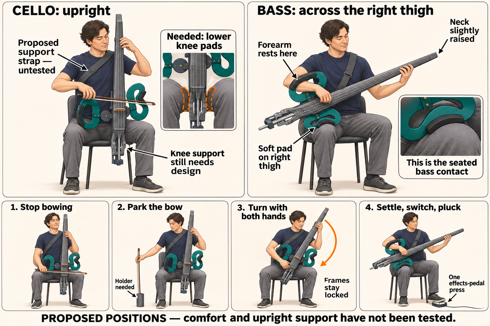

# CelloBass

CelloBass is an experimental electric cello intended for seated bowing and fingerstyle bass playing. The same rigid musical core changes orientation, with an external effects pedal selecting the sound. Padded body frames fold for travel.

**Current status — prototype design and tabletop test prints.** The playable instrument still needs upright knee supports, a secure metal-to-spine attachment, endpin retention, and physical fit and strength testing. The illustrations show proposed use. The small test prints are ready for a tabletop fit check.



## Start here

- **Print the first fit gauge.** Download [the four-part test-print kit](CelloBass_Penn_State_TEST_PRINTS_ONLY.zip), extract it, and open `START_HERE.html`. Begin with `01_PRINT_FIRST_Pin_Fit_Gauge.stl` in PLA at 100% scale. The guide covers assembly, both locking positions, and checks to perform by hand.
- **Explore the playing positions.** Download the repository using **Code → Download ZIP**, extract it, and open `output/CelloBass_Review.html` in a browser. The seated-player explanation comes first. Expand the optional section to rotate the 3D model and inspect the hinge.
- **Edit the latest assembly.** Open [the r0.3 Blender study](output/r03/CelloBass_r03_connected_study.blend) in Blender. Five scenes share the same source geometry, including a rear hinge close-up.

## Playing and folding

For the proposed cello-to-bass change, the player stops bowing, parks the bow, turns the entire instrument, settles the lower pad on the right thigh, and selects the configured external bass effects with one footswitch action. The frames stay deployed and locked during the playing change. The continuously attached supporting system still needs development and testing.

For travel, the player supports the instrument, withdraws the wing locks, folds the frames toward the neck, and engages the stow locks. The full-length reinforced musical core stays rigid. The folded study remains approximately 1.07 m long.

## Files

| Location | Contents |
| --- | --- |
| [output/print-test-kit](output/print-test-kit) | Four flat PLA test parts, assembly instructions, and hands-on checks |
| [output/r03/source](output/r03/source) | Editable CadQuery shapes, motion parameters, and review-page template |
| [output/r03/study](output/r03/study) | Latest study STEP parts, GLB assemblies, and model data |
| [output/r03/reports](output/r03/reports) | Validation results, remaining work, and seated-player explanation |
| [output/source](output/source) | Earlier parametric mechanism coupons and motion study |
| [output/stl/coupons](output/stl/coupons) | Earlier isolated bench-test coupons |
| [output/source_meshes/mm](output/source_meshes/mm) | Original evaluated O'Cello meshes in millimetres |
| [02_ORIGINAL_PROJECTS](02_ORIGINAL_PROJECTS) | Unmodified original source archives |
| [tools](tools) | Source inspection, generation, packaging, and checking scripts |

The CAD study includes illustrative pads, pins and other hardware. Production dimensions and assembly methods remain open where identified in the reports. The earlier ten coupons are independent fit tests. Use the four-part kit linked above for the current first print.

## Validation

The latest review checked source-mesh preservation, valid STEP exports, the local hinge sweep, end stops, pin alignment, locking, and withdrawal. A broader travel screen found forearm-pad contact with the rear rail. Moving the pad rearward 3 mm cleared the 201 sampled animation positions. Physical printing, assembled strength, wearer support, bow clearance, sound, and transition time remain untested.

Read [the latest revision notes](output/r03/reports/revision_notes.md), [the sampled travel check](output/r03/reports/travel_sweep_screen.json), and [the hands-on test guide](output/print-test-kit/START_HERE.html) before using the files.

## Rebuild on Windows

The existing scripts use Python 3.12 and portable Blender 4.5.15 LTS. They expect the project to be the working directory. Installed tools and the Python environment are excluded from Git.

```powershell
python -m venv .venv
& ./.venv/Scripts/python.exe -m pip install -r tools/requirements-lock.txt
python 04_TOOLS/unpack_sources.py
```

Place portable Blender at `tools/blender/blender-4.5.15-windows-x64/blender.exe`. The optional `python tools/install_blender.py` helper downloads that release from the Blender mirror and verifies its SHA256 checksum. The helper requires the `requests` package in the Python environment used to run it.

Rebuild the studies and run the geometry checks, then rebuild the four-part print kit.

```powershell
& ./tools/build_all.ps1
& ./.venv/Scripts/python.exe tools/build_library_print_kit.py
```

The complete pinned Python dependencies are in `tools/requirements-lock.txt`. The image-generation result and reference images are included as existing assets. Browser checks use an additional Playwright installation and an installed browser. The geometry build works independently of those browser checks.

## Sources and permissions

O'Cello by **Conor O'Kane** supplies the original musical geometry under **CC BY-NC 4.0**. CelloBass changes include the folding-frame and support studies. OpenBass by **tbenen** is retained as a construction reference under **CC BY-SA 4.0**. The CelloBass assembly incorporates O'Cello geometry and original new frame shapes. OpenBass geometry stays in its separate original archive.

See [LICENSE](LICENSE) for the asset-specific permissions and source links. Retain the authors' credits and license terms when sharing source-derived files.
